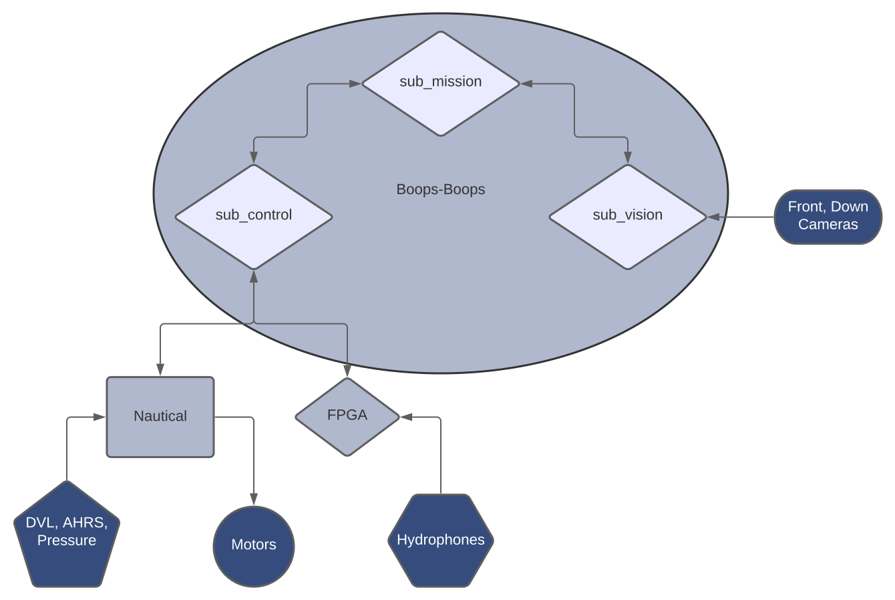

Welcome to the Boops-Boops :dolphin: wiki! Here you will find in depth explanations of how the code stack works, along with detailed information about each file in each module in the repository.

## Documentation:
* [sub_mission](./files/sub_mission.md)
* [sub_control](./files/sub_control.md)
* [sub_vision](./files/sub_vision.md)
* [sub_sim](./files/sub_sim.md)
* [Hydrophones](./files/hydrophones.md)
* [Launch Files](./files/launch_files.md)
* [Miscellaneous tutorials](./files/tutorials.md)

## Overview:

The Boops-Boops repository hosts 3 main modules: `sub_mission`, `sub_control`, and `sub_vision`, along with `sub_sim`. You'll notice that these modules aren't include with the base BB GitHub repository; this is because they are all located in their own github repositories. In order to assemble them all together, the install script takes care of that (see the README). With that, let's breakdown the modules and what their functions are.

### sub_mission
`sub_mission` is the main package that runs the entire show as the main boss, sort of like the CEO of the company. This node tells the sub when to move forward, horizontally, or vertically, and it tells the sub when to use its vision system to detect objects. It is able to send these commands because at its side, `sub_control` and `sub_vision` exist to serve it, like its deputies or henchmen.

### sub_control
`sub_control` is the lower-level module that exists to do the dirty work that `sub_mission` tells it to do. This module's job is to listen for requests from `sub_mission` for commands such as to move to a specific state or direction, and it takes this information and hands it over to the Atmega microcontroller chip that controls the AUV's thrusters. Furthermore, this module can also relay information back to `sub_mission`; for example, if `sub_mission` requests to know the state (coordinates and orientation) of the AUV, `sub_control` takes care of it by relaying the request to the Atmega, waiting for a response, receiving the response, and giving it back to `sub_mission`. Essentially, `sub_control` is like the secretary for `sub_mission`.

### sub_vision
`sub_vision` is a complementary package to `sub_mission`, as it handles requests to detect competition objects. In this package, there is code that runs member-trained machine-learning (ML) models that take an image as input, finds the object in the image, and returns the angle that the submarine needs to move to in order to orient itself towards the object. The way it works with `sub_mission` is the following: when `sub_mission` decides it needs to know where a competition object (eg. gate) is, it sends a request to `sub_vision` to handle it. In turn, `sub_vision` takes this request, runs the ML model to detect the gate from the latest image from the front-camera, and returns the relative angle that the sub needs to orient itself towards to get to the gate. Finally, `sub_mission` could use this angle information to tell the sub to move to that specific angle if the big boss desires to do so. While `sub_vision` only runs ML models when requested to do so, it is also continuously taking in images from the front and down cameras, filtering them to improve visibility, and logging them if necessary.

### sub_sim
`sub_sim` is a package that handles simulation of the submarine, the low-level control loop (Nautical), as well as the high-level navigation and camera processes. It works by launching our custom simulator featuring Nemo inside of a software called Gazebo, which simulates physics, the visual environment, and thruster forces. Secondly, it also launches a low-level control process similar to Nautical that is responsible for receiving commands from `sub_control` to move to a specific location or set a specific parameter, and it sends thrust values to the virtual thrusters to have the AUV move towards the target. 