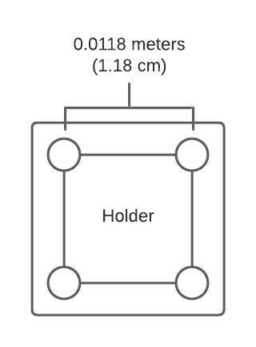
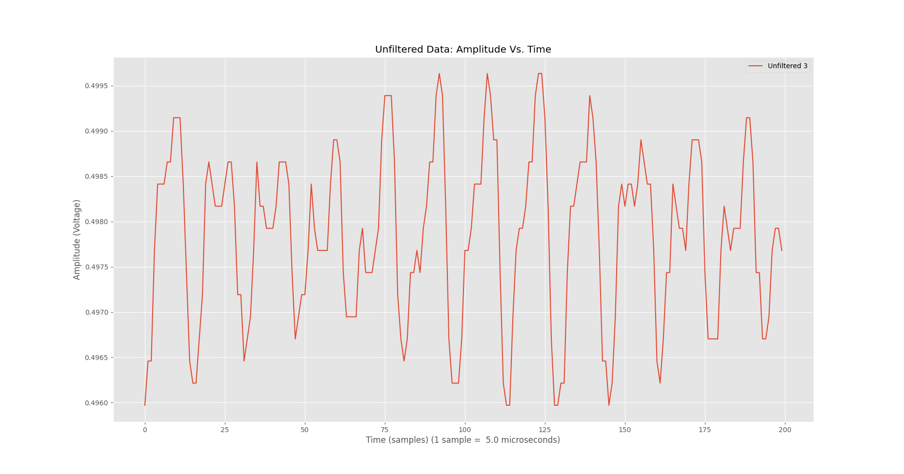
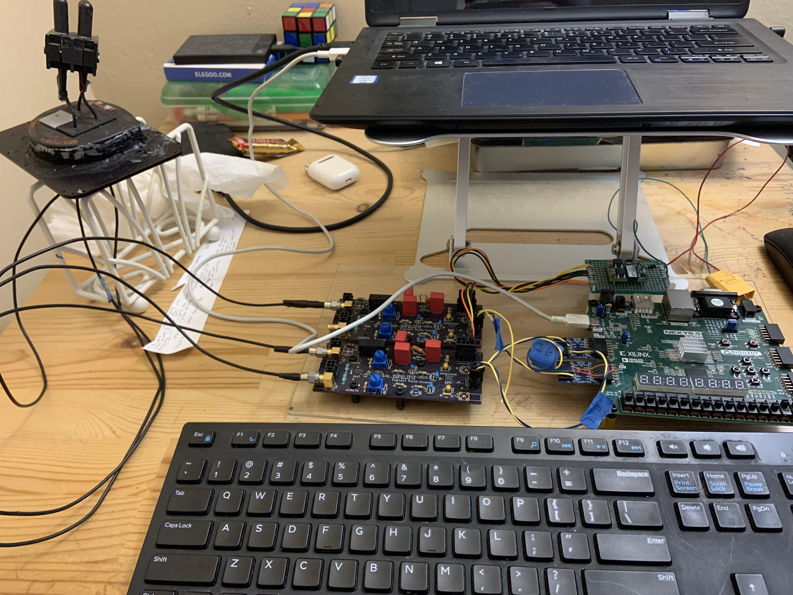
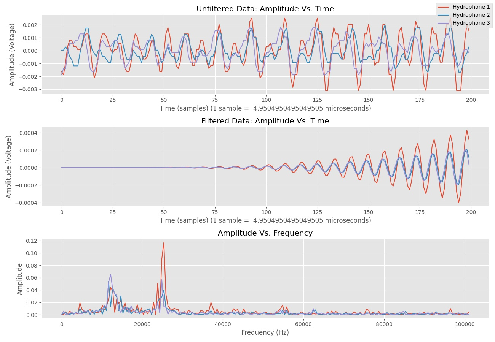
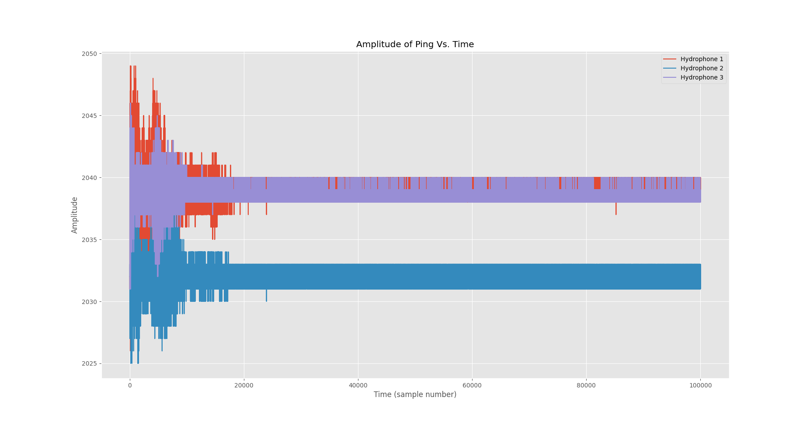
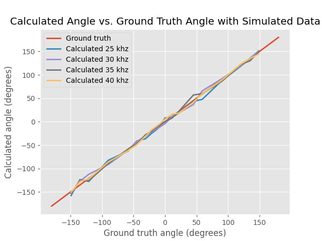

This is the current hydrophones implementation. Hydrophones are underwater microphones, that we use to listen for the pinger. The pinger is located under the octagon, and we use the hydrophones to find the angle to the octagon in order to navigate under it. 

# How It Works

As of 12-26-21, this is the (planned) hydrophones implementation.

First, we have three hydrophones in a right triangle arrangement, with the first hydrophone in the top left corner, the second hydrophone in the top right corner, and the third hydrophone in the bottom left corner.

*The hydrophone holder geometry.*

The hydrophones are then connected to an amplifier and filter board designed and created by Maxim. Since the hydrophone readings are weak in nature, the amplifier boards ramps that sh_t up so that the ping can be clearly seen, and it also does some high pass filtering so that only frequencies above 10000 Hz will be transferred over. If you graph the data as the measured value (which is the amplitude) over time (which is the sample number,) you will see that it forms a sine wave, which makes sense because it is a sound wave.

*This is data from a single hydrophone, which forms a sine wave.*

The amplifier board then connects to the FPGA (Field Programmable Gate Array), which is kind of like a computer. The FPGA is able to read the data and send the data over to the computer via a USB socket, in a serial port.

*This is the setup of the hydrophones, which includes the hydrophones connected to the amp board, which is connected to the FPGA, which is connected to the computer. On the sub, the hydrophones are panned to be outside Nemo, while the amp boards, FPGA, and onboard computer are going to be inside the sub.*

Finally, the FPGA connects to the computer, which takes care of the computations to find the angle (and hopefully coordinates.) In the computations, the computer first normalizes the data (divides by the max value and subtracts the mean value from all samples in the hydrophone channel) to make it easier to work with for the signal processing plugins. Then, it performs a butter bandpass filter, which cleans up the noise in the signal to result in some nice, clean sine waves, while also isolating the sole frequency that we're looking for. After filtering, the data (which is the amplitude of the sine wave at each sample) is passed into a Hilbert Transform, which helps us find the phase differences between each sine wave. (Side note - the hydrophones are spaced super closely so that there is no ambiguity which wave is in front of the other.) After obtaining the phase differences, these differences are then converted from radians into time (seconds.) These time differences of arrival are then inputted into an equation copied from a YouTube video, which lets us get the angle to the pinger. (In my current understanding, the equation works because as the wave hits each hydrophone, it forms sides of a triangle, which you can then use trig on to calculate an angle.)

*This is some real data processing that we did on a 25 khz ping from Justin's pool. The top is the raw data, the middle is the filtered data, and the bottom is the amplitude spectrum of the raw data (which shows how strong each frequency is in the data.)*

The final implementation is planned to look like this:
1. sub_mission requests the angle to the pinger (which is a relative yaw angle.)
2. sub_control takes the request, and sends a command via USB serial over to the FPGA to start looking for the ping.
3. The FPGA receives the command and begins collecting data. If it hears a sound over the sound threshold, it performs a Fast Fourier Transform (FFT) to see if the ping is the correct frequency (so that the pinger is coming.)
4. If the noise matches the frequency of the pinger in our pool (since there are 4 different pingers at 4 different frequencies, one in each competition pool), then return the data back to the computer. If not, then keep repeating the data collection and ping identification step until we get the correct ping.
5. The computer receives about 200 samples via USB from the FPGA, and it does the data processing steps outlined above (normalization, bandpass filter, phase difference calculations, then bearing calculation) to calculate the angle to the pinger.
6. With the angle to the pinger information, sub_control then returns this information to sub_mission.
7. sub_mission receives the angle to the pinger, and it navigates towards the pinger (using a mission code implementation outlined below.)

# Possible Mission Code Implementations

Some possible implementations of how to surface in the octagon include:
* Kush's method of taking multiple angle measurements and moving the sub, to find the intersection of the angles, which should be where the octagon lies.
* Move in the direction of the pinger until you can see the bottles task with the down camera, then using a down continuous align to align the sub in the center of the octagon, then surface.
* Move in the direction of the pinger until Nemo overtakes the pinger, at which point the angle should be reversed (eg. originally the bearing is 30 degrees, once you overtake then it would be at -150 degrees), and keep moving back and forth for a set amount of times until you feel satisfied (but this approach feels more jank and unreliable.)
* Find a way to calculate the coordinates of the pinger (in progress), which could speed up the process of finding the bottles, or we could straight up surface at those coordinates if the calculation is accurate enough.

# Improvements

* I was too lazy to put the hydrophone calculation stuff onto the FPGA, since that would involve translating stuff from Python to C. If anyone wants to do this, that would be more efficient and possibly let us shave around 1 second off of each calculation, which could be useful in comp. (My bad tho)
* If we could also calculate the coordinates of the pinger, that might make the octagon alignment faster (so we could find the bottles and align above those faster.)

# Other Interesting Stuff

*This is the overall broad picture on ping data collected in Justin's pool, with the data from 3 hydrophones combined onto one plot.*

*These are the results of the bearing calculation on simulated data. A perfect implementation would stick exactly to the straight line, while less perfect implementations would stray farther from the y = x line. On our simulated data, it looks like it's usually within +/- 5 degrees, which could be pog.*

# Useful Links
* [How to program an FPGA using Vivado](https://digilent.com/reference/vivado/getting-started-with-ipi/2018.2)
* [YouTube video on the bearing calculation](https://youtu.be/Sz_4jJKjPIQ)
* [Calculating phase difference between two signals using Hilbert Transform](https://stackoverflow.com/a/27562933)
