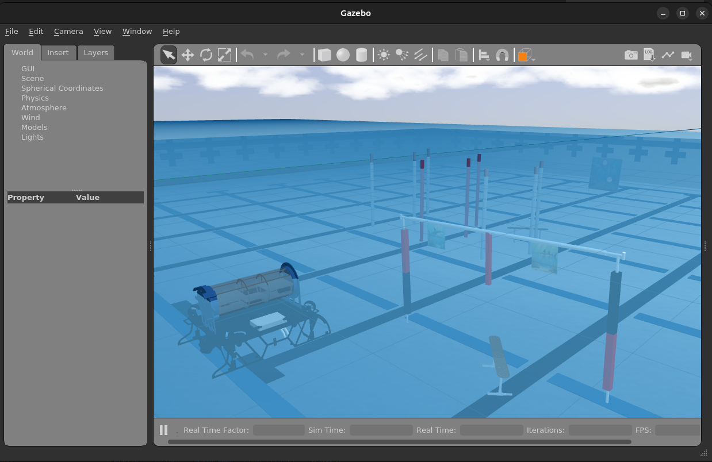

# Guide on How to Run Boops-Boops in Docker

## Prerequisites:
Ubuntu 24.04 installed, either dual booting (recommended), wiping your other OS and replacing it with Ubuntu, or using a virtual environment (not recommended due to issues with speed)

## Rationale:
As we move to newer Ubuntu and ROS versions, but we may still want to run Boops-Boops. However, ROS versions are tied to a specific Ubuntu version (unless compiled from source). Because Boops-Boops uses ROS2 Foxy, we need some way to have an Ubuntu 20.04 environment (version of Ubuntu Foxy uses) while using other Ubuntu versions like 24.04 as the OS. 

## Solution:
Docker. I recommend you watch this series to familiarize yourself with Docker and how it can be used with ROS: https://www.youtube.com/watch?v=XcJzOYe3E6M&list=PLunhqkrRNRhaqt0UfFxxC_oj7jscss2qe.

This may also enable Boops-Boops to be run other operating systems that Docker supports, like Windows or MacOS, but I don't recommend this due to the potential for odd bugs. Your milage may vary. 

## How to Use:
1. Clone Boops-Boops to your computer (`git clone https://github.com/avbotz/Boops-Boops.git`)
2. `cd` into the folder (`cd Boops-Boops`) and run the `clone_repos.sh` script (`./clone_repos.sh`)
3. Install Docker (https://docs.docker.com/engine/install/ubuntu)
4. Install the VSCode Dev Container Extension (https://marketplace.visualstudio.com/items?itemName=ms-vscode-remote.remote-containers)
5. Build and launch the container (Ctrl-Shift-P -> `Dev Containers: Rebuild and Launch the Container`)
6. Once the container is fully launched, open up a terminal and run `colcon build` to compile the packages. If your system is freezing, run `colcon build --parallel-workers 1` instead (limits to one CPU core). 
7. Source the setup scripts (sets up path to access ROS commands and compiled packages): `source setup.sh`
8. Run the simulator: `ros2 launch launch/<launch file here>.py` (use `launch/sim_image_collection.py` for testing). You should see a window like this popup:


## Troubleshooting:
If you are getting an error like this:
```
[gzserver-4] Authorization required, but no authorization protocol specified
[gzserver-4] [Err] [RenderEngine.cc:749] Can't open display: :0
[gzserver-4] [Wrn] [RenderEngine.cc:89] Unable to create X window. Rendering will be disabled
```
Open a terminal outside of the devcontainer and run `./docker_perms.sh`. 

If you are geting an error relating to Plankton not being built, you may need to run:
```
colcon build --packages-up-to Plankton
colcon build
```
Instead of just `colcon build`.
